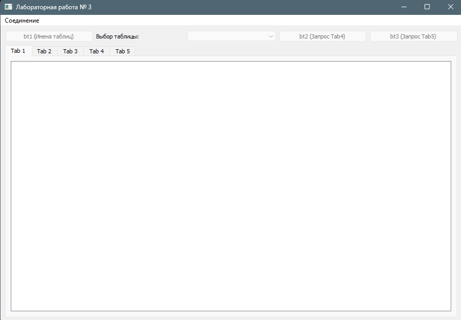
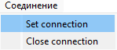
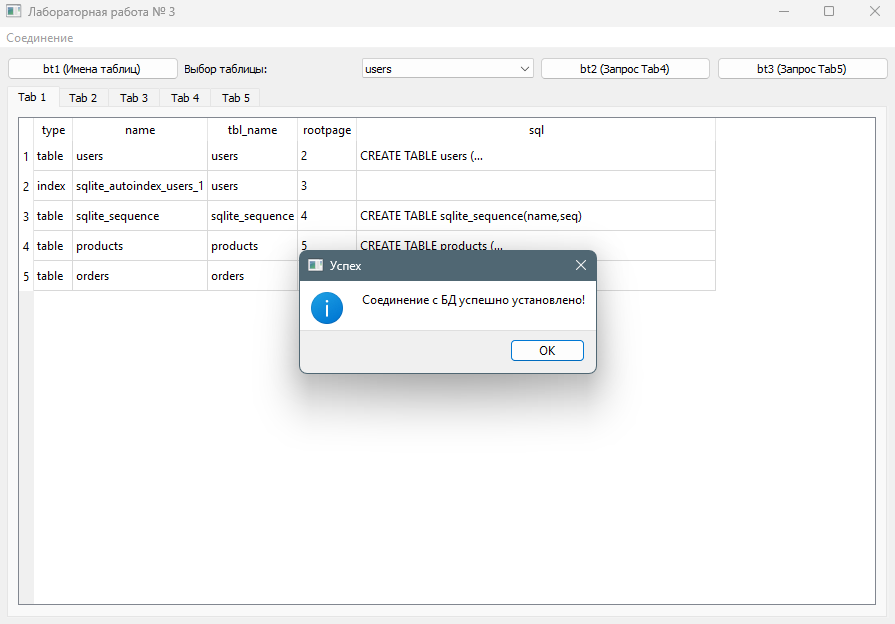
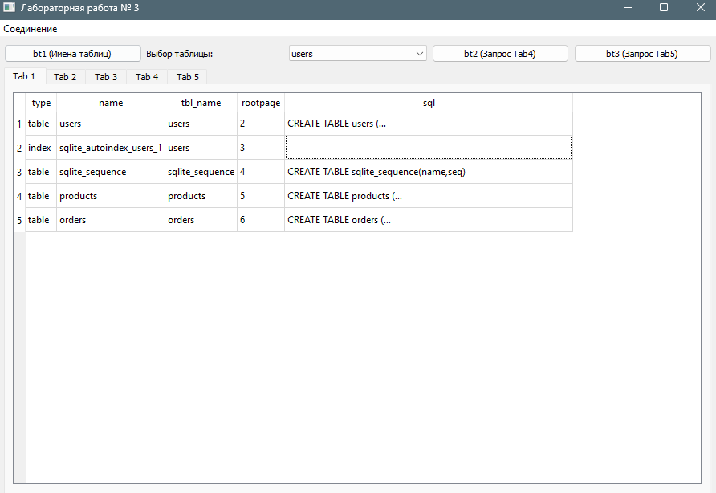
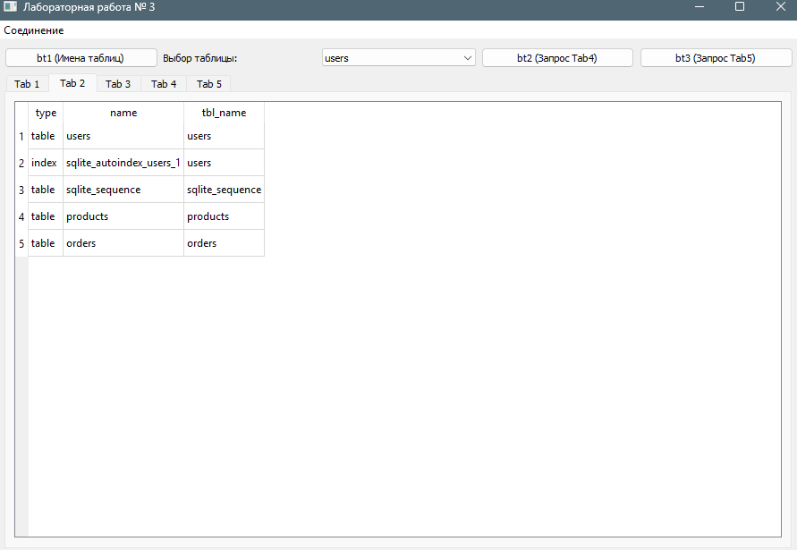
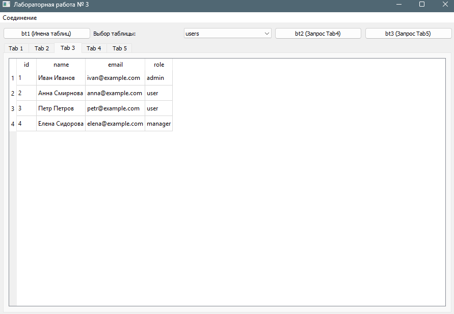
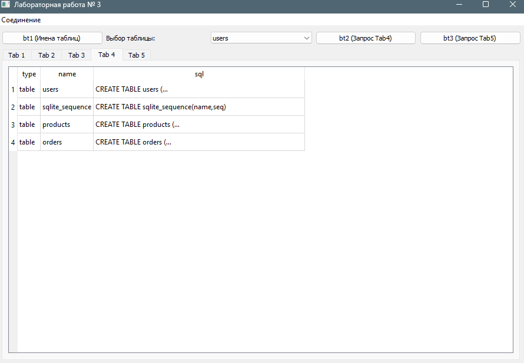
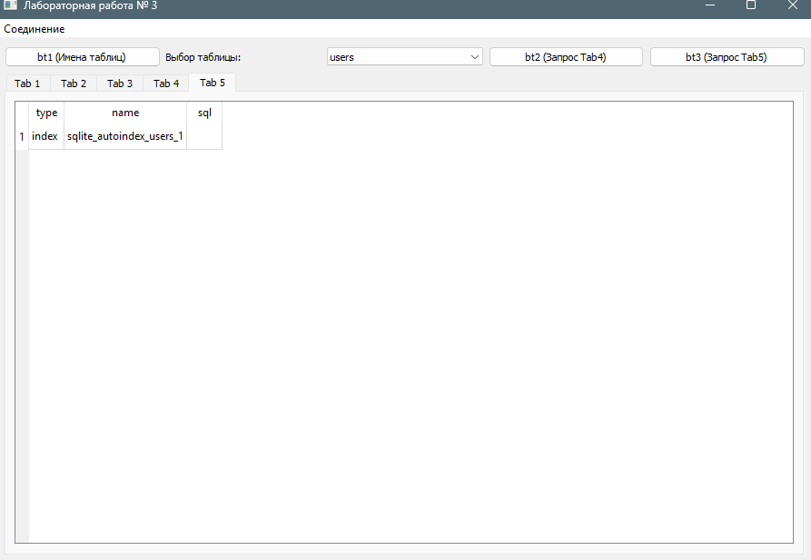
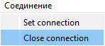

## Лабораторная работа № 3
## Васильев Артём
## Группа 6231-010402D

### Архитектура и принцип работы

Приложение представляет собой графический интерфейс для визуализации данных базы данных SQLite.

**Логика работы:**

`QSqlDataBase`: Отвечает за установку, поддержание и закрытие соединения с файлом базы данных SQLite.

`QSqlQueryModel`: Выполняет SQL-запросы к базе данных и удерживает полученные результаты в памяти.

`QTableView`: Виджет, который отображает данные из модели в виде интерактивной таблицы.

1. При вызове *Set connection* пользователь через `QFileDialog` выбирает файл `.db.`
2. Приложение открывает соединение и динамически считывает названия всех таблиц из системной служебной таблицы *sqlite_master*, заполняя ими `QComboBox`.
3. Автоматически и по нажатию кнопок `(bt1, bt2, bt3)` или при смене пункта в QComboBox формируются SQL-запросы, результаты которых передаются соответствующим вкладкам `QTabWidget`.
4. При вызове *Close connection* модели всех таблиц обнуляются, а соединение с БД безопасно закрывается

**Результат работы программы:**

Запуск программы

Попытка установить соединение

В случае успеха появляется `MessageBox` с уведомлением
об успешном соединении, иначе выдаст ошибку

`Tab1`: Автоматически заполняется при вызове `set_connection()` запросом 
`SELECT * FROM sqlite_master.`

`Tab2`: кнопка btn1 отправляет запрос 
`SELECT type, name, tbl_name FROM sqlite_master.`

`Tab3`: При выборе любой таблицы в `QComboBox` отправляется запрос `SELECT * FROM "<выбранная_таблица>".`

`Tab4`: Кнопка `btn2` выводит структуру таблиц `WHERE type='table'.`

`Tab5`: Кнопка `bt3` выводит индексы и представления `WHERE type IN ('index', 'trigger', 'view').`

Закрываем соединение 

