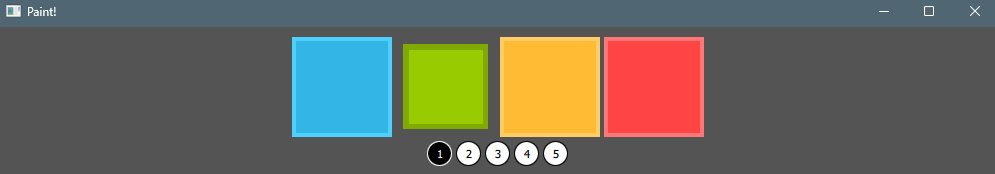
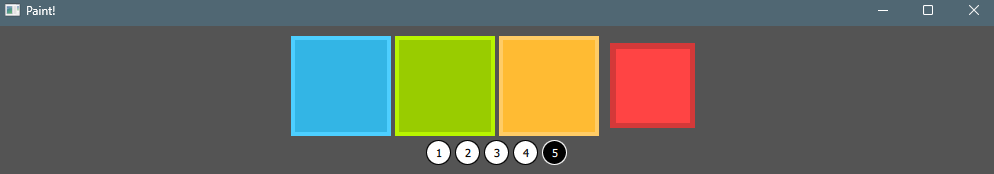
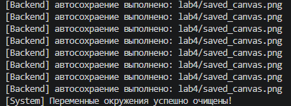

## Лабораторная работа № 4
## Васильев Артём
## Группа 6231-010402D


### Архитектура и принцип работы

`Frontend`: Отвечает за графический интерфейс пользователя (UI), выбор цвета и толщины кисти `(Square.qml, Circle.qml), а также непосредственно область рисования (Canvas в mainWindow.qml).`

`Backend`: Управляет жизненным циклом приложения `(QQmlApplicationEngine)`, инициализирует фоновый таймер `(QTimer)` и инициирует сохранение графической области `Canvas` на диск.

Для связи компонентов используется контекстное свойство *rootContext().setContextProperty()*:

```python
interface = Interface(engine)
engine.rootContext().setContextProperty("_backend", interface)
```

Чтобы из Python вызвать метод сохранения, находящийся в QML-компоненте:

1. В QML элементу `Canvas` задается логическое имя `objectName: "canvas"`.

2. В Python с помощью *root.findChild(QObject, "canvas")* находится ссылка на данный элемент.

3. Через *QMetaObject.invokeMethod(...)* выполняется вызов JS-функции saveCanvas(filePath):

```python
QMetaObject.invokeMethod(
    canvas, 
    "saveCanvas", 
    Q_ARG(QVariant, save_path)
)
```

## Логика работы `Canvas`:

- Обработка пользовательского ввода происходит через *MouseArea*. При перемещении курсора фиксируются координаты mouseX и mouseY, после чего вызывается *canvas.requestPaint().*

- В обработчике *onPaint* с помощью 2D-контекста `(getContext("2d")) `вычерчиваются сглаженные линии заданной толщины и цвета.

## Фоновое сохранение по `QTimer`:

В классе `Interface` инициализирован объект `QTimer`:

```python
self.timer = QTimer(self)
self.timer.setInterval(5000)  # Интервал 5 секунд
self.timer.timeout.connect(self.auto_save)
self.timer.start()
```

*Принцип работы*: Каждые 5000 мс (5 секунд) срабатывает сигнал timeout, вызывающий слот *auto_save().*

*Результат*: Слот автоматически определяет путь к файлу *(saved_canvas.png)* и отправляет сигнал холсту QML пересохранить текущий рисунок на диск без остановки работы пользователя.

**Результат работы программы**





Логирование таймера:

